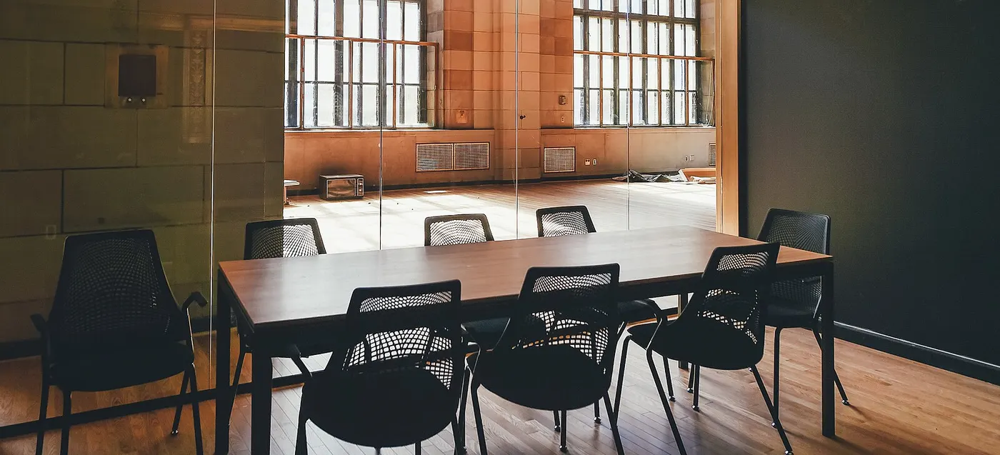
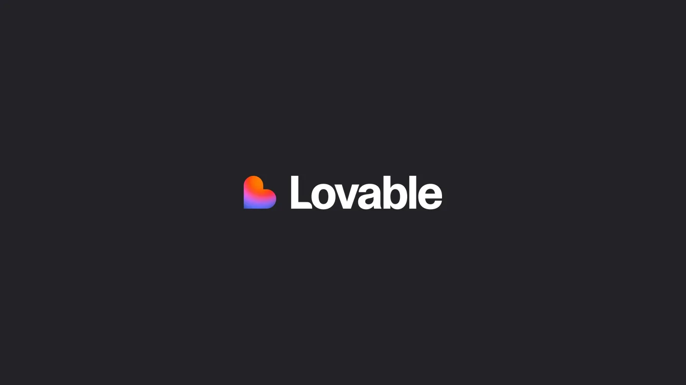
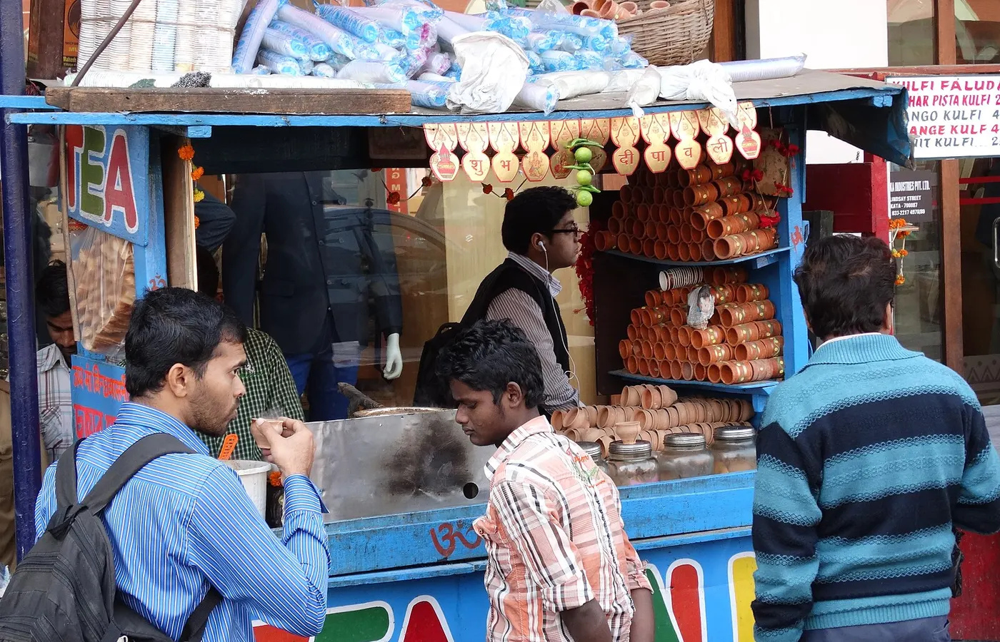
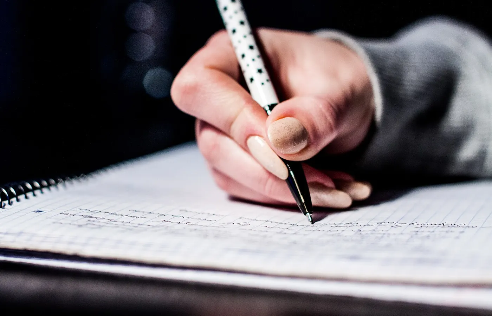
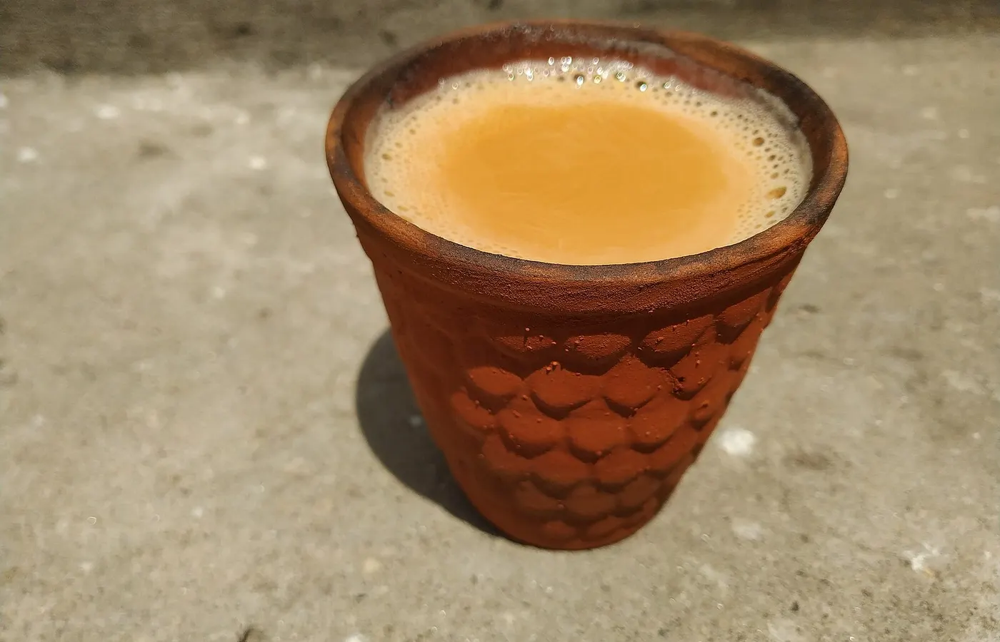

Every few weeks the same line turns up in my messages.

Will AI take my job.

It comes from friends still finishing college. From people in their first year. From someone who just watched a LinkedIn post about agents shipping features overnight. Bangalore has a way of making that question feel personal. The tech parks are full. The group chats are louder.

I work inside an AI company. I will not pretend the fear is silly. I will also not sell you a panic story.

What I can offer is plainer. The work that disappeared around me. The work that grew. And what I would practise if I were starting again this year.

## Will AI take my job? Look at the desk, not the headline

Headlines like a clean answer. A robot or a human. A yes or a no.

Desks are messier.

In the year after I joined, the company's direction moved toward automation. Fewer handoffs. More of the work done by systems, and by fewer people. Screens still had to be made. Posts still had to go out. What changed was who was left to do them.

I wrote about that shift in [how my job as a PM changed in a year](/blog/how-my-pm-job-changed-in-a-year). This piece is the next question people ask after that one. If the room got smaller, does that mean AI took the seats?

Not in the way the phrase sounds. The tools did not walk in and fire a team. The plan changed. The work stayed. Someone had to pick it up with new tools, or the feature sat unfinished.

So when someone asks will AI take my job, I hear a different sentence underneath. Will I still be useful when the handoffs get shorter?

That is a fairer question. It is also one you can do something about.

## The work that left, and the work that grew

Design was one of the first places I felt it.

The design team was removed. Completely. There are no designers now. I still needed a screen before anyone could react to a feature. So I build them in Lovable. I describe the flow. I get something people can click through while the question is still warm.

Marketing went a similar way. A feature would ship, and the words still had to exist. Not one post. A LinkedIn post. A carousel. A product video. A one-pager. A sales brief.

So I coded it. Pipelines that read a release from the codebase and turn it into those pieces. Gumloop only carries them out after they are made.

None of that was a grand plan I announced on day one. A task showed up. The person who used to take it was not there. I learned the next small piece so the work would not stop.

I am still in the same seat. I still talk to engineering. I still write the thread between people when that is what the afternoon needs. I also make more of the thing myself than I did on 9 June 2025.

AI did not take that job. It changed what the job asks for. Someone who can sit with the tools and still decide what good looks like is more useful in that room, not less.

## What AI and junior jobs look like from here

I hear a lot of anxiety about AI and junior jobs. Freshers hear that the bottom rungs are gone. That companies only want seniors who already know how to prompt.

I cannot speak for every hiring page in India. I can tell you what I watch for when a junior person sits near real AI work.

The people who struggle treat the model like a finished colleague. They paste a vague ask. They ship the first draft. They cannot say why the answer is wrong.

The people who move faster treat the model like a loud intern. Useful. Fast. Often half right. Someone still has to check the customer problem, the edge case, the line that will confuse a sales call.

That is not a soft skill you add at the end. That is the job.

Reports like the [World Economic Forum's Future of Jobs](https://www.weforum.org/publications/the-future-of-jobs-report-2025/) keep pointing at the same shape. Skills move. Roles reshuffle. The title on the offer letter is a weak map of the week.

If you are early in your career, the risky move is waiting for the market to calm down before you touch the tools. The calm move is learning them on small, real tasks, then keeping your own standards for the output.

## AI skills for freshers are not a course list

People ask me for a stack. Which model. Which app. Which certificate.

I use Cursor on the codebase. Claude drafts. Lovable for screens. Lately the Grok bot for the next step. I still read the end before anything is allowed to move. Sourabh, a PM OS I built, pulls tickets, messages, code and customer calls into one place so the PRD starts from a shared thread. That is my desk. Yours will look different.

What travels better than a brand name is a habit.

Can you take a messy ask and turn it into a clear brief before you open a chat window?

Can you show a screen, a paragraph, or a small demo the same day someone asks, instead of waiting for a perfect handoff?

Can you spot when the model invented a number, a customer, or a step that never happened?

Can you finish? Not a tab of drafts. One artifact someone else can use on Monday.

Those are AI skills for freshers in the sense that matters. The tools change every quarter. Judgement compounds.

If you want a practice plan for this year, keep it small.

1. Pick one tool and use it every week on real work, not only demos.
2. Keep a short before-and-after note. What you asked. What you changed. What you threw away.
3. Ship one thing a month that a manager, mentor or friend can open without you explaining it.
4. Read one piece of work you did not generate. A call transcript. A support ticket. A competitor page. Stay close to the problem.

I learned a lot of my current week while the task was already due. I wrote about the early stretch of that seat in [what my first year as a product manager actually looked like](/blog/first-year-as-a-product-manager). The title stayed still. The Tuesday did not. AI made that pattern louder, not quieter.

## The future of work India will reward people who stay close to the problem

I grew up far from this city. Darjeeling. Then Kolkata. Then IIT Dhanbad. Now Bangalore, in a company that builds AI for enterprise contact centres.

From here, the future of work India does not look like a single replacement event. It looks like desks where the handoff used to be a person, and is now a system, and still needs a human who cares whether the answer is true.

Will AI take my job is the question that trends. Will I still be the person who notices the gap is the question that pays rent.

You do not need to become an engineer overnight. You do need to stop treating AI as weather that happens to other people.

Make something with it this week. Check it like it matters. Put your name on the version you would defend in a meeting.

AI will not take your job by itself.

Someone who uses it well, on the work that still has to leave the building, might.
