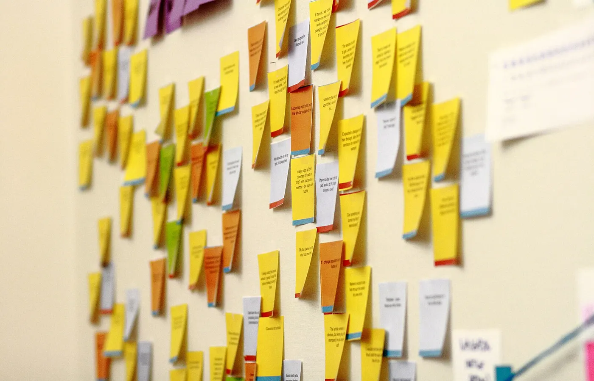

Friday evening in Bangalore. The week is almost over. The draft is still empty.

I have sat in that seat more than once. Tabs open. A half-written paragraph about meetings. A feeling that if I list everything I touched, someone will finally see the work.

They will not. Not like that.

How to write a weekly status update starts smaller than the whole week. Start with the one thing you need your manager to decide, unblock, or notice. The rest of the note hangs off that line.

## How to write a weekly status update that starts with one decision

Most weekly updates fail for a kind reason. You worked hard. You want the page to prove it. So the note becomes a diary. Six projects. Four meetings. A risk buried in line fourteen.

Your manager is not looking for a diary. They are looking for a signal.

I learned that the slow way. In [my first year as a product manager](/blog/first-year-as-a-product-manager), a lot of the job was one sentence that survived three conversations. A weekly update is the same craft, written down for someone who was not in every room with you.

Before you open the mail client, write one line on paper.

What do I need from them this week?

A yes. A no. Cover on a hire. A call with another team. Permission to cut scope. If you cannot name it, you are not ready to send. You are still sorting your own head.

When the company's direction moved and my week got louder, the habit got sharper. I wrote about that shift in [how my job as a PM changed in a year](/blog/how-my-pm-job-changed-in-a-year). More of the work landed on fewer desks. A long status report to manager does not help in that room. A clear ask does.

## A weekly update template you can save

Keep the shape boring. Boring is what gets skimmed and still understood.

Here is a weekly update template I would paste into a Friday draft and fill in under ten minutes.

1. **Decision needed.** One sentence. What you want them to do or say.
2. **This week.** Three bullets max. Outcomes, not attendance. Shipped, unblocked, learned.
3. **Next week.** Two or three bullets. The smallest set that matters.
4. **Risks / blockers.** Only the ones that need air. Name the owner if you can.
5. **Links.** The doc, the ticket, the prototype. Do not paste the whole page into the mail.

That is the whole form. Five blocks. No soft landing at the bottom.

If a block is empty, leave it empty or delete it. An empty risks line is better than inventing drama. An empty decision line means you should not send yet.

People ask for tools. I use Sourabh to pull tickets, messages and code into one place before I write a PRD. A Friday update is smaller than that. You do not need a system. You need the five headings and honest bullets.

## Before and after: a status report to manager

Take this as a picture. Not a real mail. An illustrative pair so you can feel the difference.

**Before.**

"Had a busy week. Synced with engineering on a few threads. Looked at the new flow. Talked to marketing about messaging. Customer call was interesting. Will continue next week on several fronts. Let me know if you have thoughts."

That status report to manager is polite. It is also unreadable. There is no ask. There is no finish line. A manager who opens twenty of these on Monday will remember none of them.

**After.**

"Decision needed: can we cut the second screen from next week's release so engineering can finish the first path?

This week: first path is in review. Prototype of the second screen is paused. Sales brief draft is ready for a once-over.

Next week: ship the first path if review clears. Hold the second screen until you say go.

Risk: if we keep both, review slips past Thursday.

Link: [ticket / doc]"

Same week. Different job. The second version can be answered in one reply.

Notice what left the page. The interesting customer call. The marketing chat. The feeling of being busy. Keep those for your own notes if you want. They do not belong in the mail unless they change the decision.

## How to send the work update email without burying the week

A work update email is not a performance. It is a handoff.

Subject line first. Put the decision in it when you can. "Weekly update — need a call on scope for the second screen" beats "Weekly update — week of 20 Oct". The subject is often the only line that gets read on a phone in traffic.

Send on Friday evening, IST, while the week is still warm. Monday morning means your note joins a pile that already grew over the weekend. I would rather send a slightly rough Friday draft than a polished note that arrives after the standup has already moved on.

Keep the body short enough to read without scrolling twice. If you need a longer write-up, link it. Atlassian’s own guide to the [product manager role](https://www.atlassian.com/agile/product-management/product-manager) talks about driving clarity on what success looks like. Your update is that clarity for seven days, not a second roadmap.

One more habit. Read the mail once as if you are the manager. Ask: can I answer this in two minutes? If the answer is no, cut until it is yes.

## What gets read is what can be answered

I still like writing. I still want the week to sound like it mattered. The craft is knowing which parts of the week are for you, and which parts are for the person who has to steer three other people’s weeks at the same time.

How to write a weekly status update is not a mystery of tone. It is a sequence. Name the decision. Fill a short weekly update template. Show outcomes, not motion. Put the ask in the subject. Send while Friday still feels like Friday.

Save the template. Use it next Friday. If your manager can reply with one clear line, you did the job.
